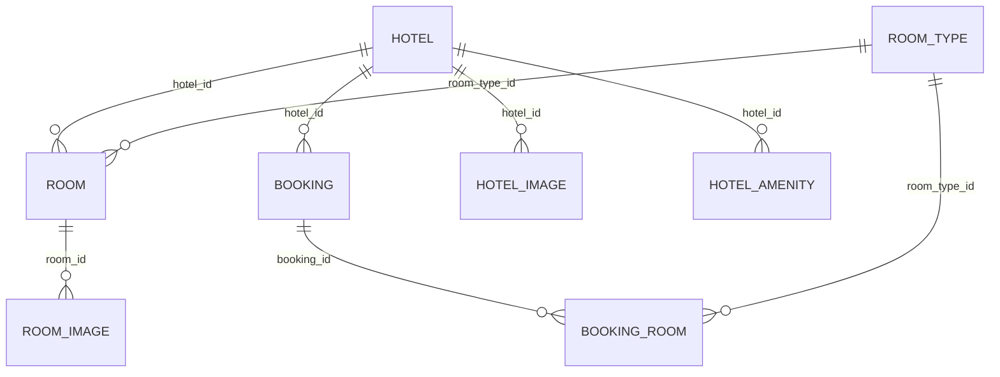
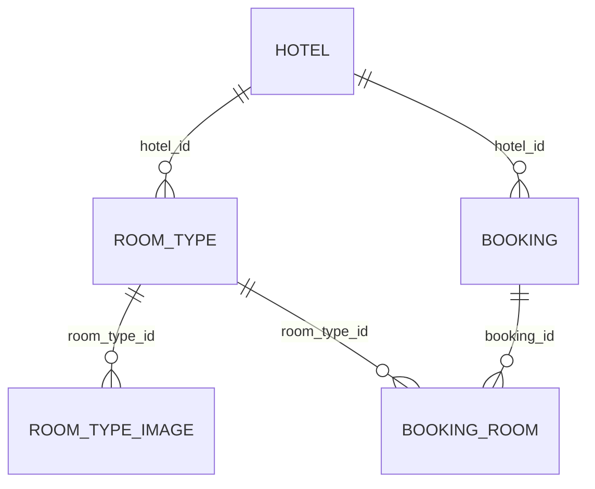

# AUREL — Audit Hotel & Room Management

Ngày audit: 11/10/2026. Phạm vi: schema thực tế, routes đang chạy, Admin Hotel/Room, Hotel Detail, tồn phòng, Booking và các phụ thuộc hiển thị/thanh toán.

**Chỉ audit. Không chỉnh source ứng dụng, Authentication, Hotel Detail, database hoặc migration; không chạy migration/seeder, không commit/push. File mới duy nhất là báo cáo này.**

## 1. Kết luận chính

Hệ thống đang dùng **mô hình lai**. Khách trên Hotel Detail chọn loại phòng và số lượng, API Booking cho phép `room_id = null` với `quantity`. Tuy nhiên, tồn kho, quan hệ khách sạn–loại phòng và ảnh loại phòng vẫn phụ thuộc vào các dòng phòng vật lý.

Muốn đạt mô hình AUREL “Khách sạn → Loại phòng → Số lượng → Booking” đầy đủ, cần loại phòng thuộc trực tiếp một khách sạn, có tồn kho/trạng thái/ảnh riêng. Việc chỉ ẩn trường tầng hoặc số phòng trong Admin chưa thay đổi kiến trúc này.

Điểm cần xử lý sớm: trùng số phòng khi thêm loại phòng, mất tiện nghi khi lưu Hotel, thiếu kiểm tra sức chứa ở server, số lượng sai trong lịch sử Booking, và chức năng quản lý loại phòng còn thiếu. Không mở khóa checkout hiện tại trước khi xác minh sức chứa và luồng thanh toán.

## 2. Database và quan hệ hiện tại

Connection đã xác minh: **mysql**, host **127.0.0.1**, port **3306**, database **hotel_booking**, MySQL **8.0.30**. Các bảng liên quan dùng InnoDB. Truy vấn audit thực hiện trong transaction `READ ONLY`, kết thúc bằng rollback; không gọi endpoint ghi dữ liệu.

| Bảng | Số dòng lúc kiểm tra | Dữ liệu/quan hệ chính |
| --- | ---: | --- |
| `hotel` | 21 | FK `location_id`; tên, địa chỉ, tọa độ, sao, mô tả, liên hệ, giờ nhận/trả, status, rating. |
| `room_type` | 6 | Tên, capacity, base_price, bed_type, description. **Không có hotel_id, tổng tồn, trạng thái, diện tích hoặc chính sách.** |
| `room` | 336 | FK hotel_id/room_type_id; room_number bắt buộc, floor nullable, price, capacity, status. |
| `booking` | 0 | Customer, Hotel, ngày, tổng khách, tổng tiền, status, hạn giữ chỗ. |
| `booking_room` | 0 | FK Booking/RoomType; quantity, nights, price_at_booking; room_id nullable. Đây là tên thật, **không có bảng booking_rooms**. |
| `room_availability` | 0 | Hotel/RoomType/date, total_rooms, available_count, booked_count; unique theo Hotel/Type/ngày. |
| `hotel_image` | 21 | FK Hotel; image_url, caption, is_primary. |
| `room_image` | 336 | FK Room vật lý; image_url, is_primary. Không có ảnh gắn trực tiếp RoomType. |
| `hotel_amenity` | 190 | FK Hotel; amenity, icon. Chưa có bảng tiện nghi loại phòng. |
| `payment`, `invoice`, `invoice_item` | 0 | Tiền thanh toán/hóa đơn liên kết Booking, không phải bảng giá phòng theo ngày. |
| `location` | 8 | Địa điểm khách sạn. |

Có 11 Hotel active và 10 inactive tại lần truy vấn số liệu. Tất cả 336 Room đang mang status available. Mỗi Hotel có 16 Room: Standard 5, Superior 4, Deluxe 3, Suite 2, Family 2.

Năm RoomType này được **dùng chung bởi cả 21 Hotel**; tổng 105 cặp Hotel/RoomType. Presidential (id 6) chưa gắn Room nào. Loại chưa sử dụng này không tự chứng minh lỗi tạo dữ liệu.

Schema hiện tại:

`booking_room.room_id` chỉ có index, **không có foreign key** trong database thực tế. Model vẫn có quan hệ tới Room. Quan hệ Hotel–RoomType được suy ra qua Room, không có ownership trực tiếp.

Các ràng buộc cần giữ khi thiết kế lại:

- Room: unique `(hotel_id, room_number)`; FK Hotel xóa cascade, FK RoomType NO ACTION.
- Booking → Hotel: NO ACTION, ngăn xóa Hotel còn Booking.
- BookingRoom → Booking: CASCADE; → RoomType: NO ACTION.
- RoomImage → Room: CASCADE; HotelImage/HotelAmenity → Hotel: CASCADE.
- RoomAvailability → Hotel/RoomType: CASCADE.

Không có bảng giá theo ngày/mùa, room amenity hoặc hotel/room policy trong schema đang hoạt động. Giá hiện được lưu ở **room.price** và **room_type.base_price**. Hiện 336 dòng không lệch giá/capacity so với RoomType; nguy cơ hai nguồn giá lệch nhau là rủi ro khi bổ sung chỉnh sửa, chưa phải lệch dữ liệu đã xảy ra.

## 3. Tồn phòng và Booking đang hoạt động thế nào?

Nguồn tồn đang dùng là `RoomAvailabilityService`, không phải `room_availability`:

1. Lấy Room theo đúng Hotel/RoomType.
2. Đếm stock có status available.
3. Lấy BookingRoom cùng Hotel/Type, có giao ngày: check_in < ngày trả và check_out > ngày nhận.
4. Loại Booking cancelled/expired. Pending, confirmed và các trạng thái khác còn lại vẫn tiêu thụ tồn trong khoảng ngày.
5. Với dòng không gán room_id, cộng quantity. Với dòng gán phòng vật lý, xử lý theo room_id, tránh tính trùng cùng phòng.
6. Dùng sự kiện nhận/trả để tìm mức chiếm dụng lớn nhất trong khoảng lưu trú. Ngày checkout không chiếm đêm đó.
7. available_rooms = max(0, stock_available − peak_consumed_stock). Không cộng dồn máy móc các Booking không cùng chiếm một đêm.

Bằng chứng: `app/Services/RoomAvailabilityService.php:24–103`.

Luồng tạo Booking dùng transaction, khóa Hotel bằng `lockForUpdate`, kiểm tra Hotel active, kiểm tra loại/phòng thuộc Hotel, kiểm tra tồn rồi lưu Booking + BookingRoom trong cùng transaction. Giá được tính lại từ RoomType ở server; không tin total_price từ browser. Dòng BookingRoom lưu giá tại thời điểm đặt, số đêm và quantity.

Bằng chứng: `app/Services/BookingService.php:51–90`; `app/Http/Controllers/BookingController.php:17–29`.

Khóa Hotel giúp tuần tự hóa các request tạo Booking cùng khách sạn theo đường này, gồm request đặt loại phòng và phòng cụ thể. Không có cơ sở để kết luận mọi Booking bình thường đang overbook. Chưa kiểm thử lại đồng thời trong audit chỉ đọc này.

Khi Hotel inactive/closed: không nhận Booking mới, Hotel Detail/API phòng công khai không trả Hotel đó. Booking cũ không bị tự động hủy do thao tác tắt Hotel; history/detail/payment/invoice có thể tải Hotel inactive qua quan hệ không lọc active. Đây là kết luận từ code; database hiện không có Booking để thử đơn thật.

RoomType chưa có status và chưa có API tắt, nên chưa có luồng thực tế để xác minh “tắt loại phòng nhưng giữ Booking cũ”.

## 4. Admin hiện có và còn thiếu

Routes thực tế từ `php artisan route:list --path=api --json`:

| Chức năng | Trạng thái |
| --- | --- |
| Thêm/sửa Hotel | POST /api/admin/hotels; PUT /api/admin/hotels/{id}. Có form và action backend. Chưa thử ghi trong audit. |
| Bật/tắt/đóng Hotel | PUT /api/admin/hotels/{id}/status; UI Bật/Tắt và select active/inactive/closed. |
| Xóa Hotel | Chưa có route DELETE hoặc nút xóa. |
| Danh sách RoomType | Có GET /api/admin/hotels/{hotelId}/room-types; trả RoomType + tổng rooms_count, **không phải phòng trống theo ngày**. |
| Thêm RoomType | Có POST cùng URL; tạo loại phòng và N Room vật lý. |
| Sửa/xóa/tắt RoomType | Chưa có API hoặc giao diện hoàn chỉnh. |
| Điều chỉnh số lượng loại phòng đang có | Chưa có; room_count chỉ dùng khi tạo mới. |
| Ảnh Hotel/RoomType | Chưa có upload/gallery CRUD trong Admin. |
| Tiện nghi Hotel | Có checkbox và backend ghi hotel_amenity, nhưng danh mục không thống nhất. |
| Tiện nghi/chính sách/diện tích RoomType | Chưa có schema và form/API. |

Routes Admin đang gọi **app/Http/Controllers/AdminController.php**. Các bản `Admin/HotelController.php`, `Services/Admin/HotelService.php` và `Services/HotelService.php` tồn tại song song nhưng không phải đường xử lý Hotel/Room API đang đăng ký. Không nên sửa nhầm bản service chưa được dùng.

UI “Phòng” chỉ mở modal **thêm** RoomType, không hiển thị danh sách để chỉnh sửa. Form bắt nhập tầng bắt đầu và thông báo tự tạo 101, 102…; các trường này không cần khách thấy hoặc Admin quản lý trong mô hình AUREL.

## 5. Đối chiếu Admin với Hotel Detail

| Trường/nhóm | Nguồn Hotel Detail | Khả năng quản lý Admin |
| --- | --- | --- |
| Tên, địa chỉ, địa điểm, sao, mô tả | hotel + location | Có. |
| Giờ nhận/trả, tọa độ bản đồ | hotel | Có; google_place_id không có input, 21 Hotel chưa có giá trị. |
| Rating/review | review và quan hệ Hotel | Là dữ liệu review, không nên dùng như trường sửa nội dung Hotel. |
| Gallery Hotel | hotel_image qua gallery_image_urls | Không có quản lý; Admin hiện dùng ảnh Picsum theo ID. |
| Tên/mô tả/giường/sức chứa/giá loại phòng | room_type | Chỉ có tạo, chưa sửa/tắt. |
| Ảnh loại phòng | Gộp ảnh các Room cùng Hotel/RoomType, loại URL trùng | Không có quản lý riêng. |
| Số lượng có thể đặt | API phòng theo ngày, grouped availability | Admin chỉ thấy tổng số Room, chưa chỉnh tồn. |
| Tiện nghi Hotel | hotel_amenity | Có nhưng dễ mất giá trị khi lưu. |
| Diện tích, tiện nghi, chính sách loại phòng | area = null; amenities/policies = [] | Không có dữ liệu thật hoặc editor. |
| Chính sách trẻ em/hủy/điều kiện giá | Chỉ có câu yêu cầu liên hệ Hotel | Chưa lưu chính sách cụ thể. |

Bằng chứng: `resources/views/Hotel-detail.blade.php:6–25` và các partial Hotel Detail.

Hotel Detail đã group theo RoomType, không cho khách chọn phòng 101/102. Chọn đúng một loại, số lượng 1–10; UI kiểm tra tổng sức chứa capacity × quantity. Đọc tồn có ngày bằng API /hotels/{id}/rooms, không khẳng định còn trống khi chưa chọn ngày.

**Checkout đang bị khóa chủ động**: button disabled trong sidebar-section:23, calcPrice luôn đặt disabled=true tại sidebar-script:64. Không có listener mở checkout cho nút này. Modal cũ còn gọi stopQrCountdown/confirmPayment/closeCheckout nhưng không tìm được định nghĩa trong source/assets đang tải. /booking/{id} còn route nhưng controller gọi view('booking') không tồn tại. Không sửa/mở lại các phần này trong audit.

## 6. Vấn đề đã xác nhận

| Mã | Kết luận và bằng chứng | Tác động |
| --- | --- | --- |
| H01 | createRoomType sinh số từ đầu theo floor_start ở AdminController:314–329. Tính mặc định 101–105 tại Hotel 1: cả 5 số đã tồn tại; DB unique uq_room. | Thêm loại mới bằng mặc định sẽ gặp trùng số. Đã kiểm tra giao tập chỉ đọc, chưa gửi POST. |
| H02 | RoomType được tạo trước vòng Room; không có transaction bao toàn bộ thao tác. Hotel + amenities cũng chưa được bao transaction. | Lỗi giữa chừng có thể để lại loại/phòng/Hotel đã ghi một phần. Chưa thử tạo lỗi trên DB. |
| H03 | Admin có airport, thiếu room_service; DB có airport_shuttle (16 dòng) và room_service (21 dòng). openEdit chỉ chọn giá trị có trong AMENITY_LIST; updateHotel xóa rồi tạo lại. | Lưu lại Hotel có thể mất tiện nghi không có checkbox, kể cả khi chỉ sửa tên. Hotel 1 có cả hai giá trị bị loại khỏi danh mục. |
| H04 | Admin thumbnail dùng picsum.photos/seed/id; API Hotel Admin không trả images hoặc cover_image_url. | Ảnh Admin không phản ánh gallery trên Hotel Detail; mô tả “ảnh tự động” không phải tính năng gắn ảnh thật. |
| H05 | Controller chỉ yêu cầu num_guests >= 1; BookingService không kiểm tra num_guests <= capacity × quantity. Validator lấy trực tiếp từ source chấp nhận 99 khách/1 phòng capacity=2. | Có thể vượt sức chứa bằng client/API khác. Không tạo Booking để kiểm thử. |
| H06 | User history dùng booking_rooms.length thay quantity tại bookings-script:186/306. Fixture chỉ trong RAM: một dòng quantity=3 hiển thị 1. | Số phòng hiển thị sai cho đặt nhiều phòng cùng loại. |
| H07 | User history đọc images[0].image_path trong khi DB/API dùng image_url. Fixture có image_url vẫn chọn Picsum. | Ảnh lịch sử Booking không đồng bộ với dữ liệu Hotel. |
| H08 | KPI active/inactive/rating lấy 15 Hotel trang hiện tại; total lấy toàn bộ. Probe: trang có 8 active, DB có 11. | KPI không cùng phạm vi dữ liệu. |
| H09 | Hotel validator cho tên max255/địa chỉ max500, schema max200/max300; fixture 210/310 ký tự vẫn qua validator. Description/phone/time/amenities.* chưa đủ rule. | Có thể lỗi DB/thông báo chung khi lưu; chưa thử ghi gây lỗi. |
| H10 | updateHotel bỏ mọi giá trị null bằng array_filter; middleware chuyển input rỗng thành null. | Không thể xóa rõ ràng các giá trị nullable cũ như email/phone/description/tọa độ theo ý người nhập. |
| H11 | Quan hệ Hotel–RoomType chỉ qua Room; 5 loại dùng chung 21 Hotel. | Sửa base_price/name/capacity toàn cục sẽ ảnh hưởng nhiều Hotel; không thể mặc định RoomType thuộc riêng một Hotel. |
| H12 | Admin Booking API load rooms/room_numbers, không load bookingRooms.roomType/quantity tại AdminController:135–162. | Quản lý Booking chưa cung cấp đầy đủ loại phòng và số lượng cho đơn không gán room_id. |

H01/H03/H05/H06/H08/H09 có kiểm tra chỉ đọc hoặc fixture; các điều kiện gây lỗi còn lại được xác nhận từ code/schema. Không có Booking thực tế và không có bằng chứng log về lỗi uq_room trong các dòng log đã tìm; không quy các lỗi dữ liệu giả định thành sự cố đã xảy ra.

## 7. Rủi ro cần kiểm thử thêm và bảo toàn Booking

- **Đổi trạng thái Booking:** AdminController:168–179 cho chuyển trực tiếp sang pending/confirmed/cancelled/completed, chưa kiểm tra chuyển trạng thái hợp lệ hoặc tồn dưới cùng lock. Khôi phục cancelled/expired thành confirmed sau khi tồn đã được người khác đặt có nguy cơ overbook. Nhánh code đã xác nhận; chưa tái hiện ghi/concurrency.
- **Giảm tồn:** hiện chưa có API giảm số lượng. Khi xây dựng phải kiểm tra toàn bộ Booking giữ tồn trong tương lai dưới lock; không được giảm thấp hơn mức cam kết rồi âm thầm hủy Booking.
- **Giá:** Booking total_price và price_at_booking/nights/quantity là snapshot, nên đổi giá mới không tự sửa số tiền Booking cũ. Invoice/email dùng snapshot. Tên Hotel/RoomType và chính sách không có snapshot đầy đủ, nên thông tin hiển thị có thể thay theo dữ liệu mới.
- **Hai nguồn giá/capacity:** Home/API giá tối thiểu từ room.price; Hotel Detail/Booking từ room_type.base_price. Chưa có lệch hiện tại, cần kiểm tra đồng bộ khi thêm editor.
- **Hết hạn:** RoomAvailabilityService không tự loại pending đã quá expires_at; phụ thuộc job đổi status. Job được schedule mỗi phút nhưng audit không xác minh tiến trình scheduler của máy có chạy.
- **Job cũ:** CancelExpiredBookings:42–64 vẫn tăng/giảm room_availability dù create/availability hiện không dùng bảng này. Bảng đang rỗng nên chưa có giá trị bị lệch; nếu dùng lại có thể sai counter. Job lấy pending ngoài transaction rồi update chưa recheck status, cần test race với Admin confirm/payment.
- **Cash hold 15 phút:** cash Booking pending có expires_at=15 phút và nằm trong job hủy. Cần thống nhất quy tắc thanh toán tại quầy trước khi coi đó là Booking bảo đảm tới ngày nhận phòng.
- **Integrity/đơn lặp:** room_id không FK; quantity không CHECK trong DB. Unique Booking theo Customer/Hotel/ngày/status có thể cản trở đặt nhiều loại phòng bằng các đơn riêng hoặc chuyển nhiều đơn sang cùng status. Cần kiểm thử đơn nhiều loại và hủy/đặt lại nếu cho phép.
- **Thanh toán:** banking hiện xác nhận/ghi success theo nhánh BookingService có sẵn; createManual có semantics khác. Việc ngân hàng thật đã xác nhận, payment retry và race với expiry cần audit/test riêng, không suy ra từ nhãn giao diện.
- **Xóa:** không dùng hard delete Hotel/Type có Booking. FK NO ACTION hiện giúp chặn nhiều trường hợp, nhưng xóa Room có thể làm mất ảnh và để room_id dangling vì thiếu FK.

## 8. Cấu trúc quản lý đơn giản hơn được đề xuất

Mô hình đích:

- Hotel giữ dữ liệu đang có; quản lý gallery và tiện nghi thật; active/inactive/closed quyết định nhận đơn mới.
- RoomType **thuộc một Hotel**, quản lý tên/mô tả, giường, sức chứa, giá mỗi đêm, total_rooms, trạng thái và ảnh. Không có floor_start/room_number trong thao tác quản trị thường dùng.
- BookingRoom giữ room_type_id, quantity, nights, price_at_booking. Khách không gửi room_id. Giai đoạn chuyển tiếp có thể giữ room_id nullable để đọc lịch sử cũ.
- Tồn theo ngày = tổng có thể bán trừ quantity của Booking còn chiếm tồn từng đêm; lượng đặt được cho toàn bộ chuyến đi là mức thấp nhất qua các đêm. Lưu Booking và kiểm tra tồn dưới cùng lock/transaction.
- Giữ một nguồn giá/capacity từ RoomType. Tắt Hotel/Type ngăn đơn mới, giữ đơn đã tồn tại.
- Thêm diện tích, tiện nghi phòng, chính sách trẻ em/hủy hoặc giá theo ngày khi yêu cầu nghiệp vụ được thống nhất; không giả các dữ kiện này bằng text mặc định.

Giao diện Admin nên có danh sách Hotel → danh sách RoomType (tên, giá, capacity, tổng tồn, trạng thái, ảnh) → form thêm/sửa. Thao tác giảm tồn cần thông báo rõ khi vướng Booking. Ưu tiên tắt thay xóa đối với dữ liệu đã phát sinh Booking.

## 9. Phần không cần đổi schema và phần cần migration

**Có thể sửa bằng frontend/backend hiện tại, sau khi được duyệt:**

- Đồng bộ danh mục tiện nghi, giữ giá trị chưa được editor hỗ trợ; validate amenities.*.
- Trả và dùng cover_image_url/gallery thật, bỏ Picsum. Upload/CRUD HotelImage có thể dùng bảng đang có.
- Sửa số lượng history thành tổng quantity; Admin Booking load BookingRoom/RoomType.
- KPI dùng aggregation cùng phạm vi hoặc ghi rõ chỉ thống kê trang hiện tại.
- Đồng bộ độ dài/rule validation với schema; phân biệt bỏ qua field và yêu cầu xóa nullable field.
- Transaction cho tạo Hotel/tiện nghi/RoomType/Room; tránh trùng số phòng nếu tạm giữ kho Room phía sau.
- Bổ sung capacity check ở backend; quy tắc chuyển trạng thái và lock/tồn chung khi khôi phục Booking.
- Có thể làm editor tổng số lượng bằng đếm/điều chỉnh Room trong giai đoạn tạm, với kiểm tra cam kết Booking. Đây vẫn là kiến trúc dựa trên Room, chưa phải loại bỏ phòng vật lý.
- Đơn giản hóa form bỏ tầng khỏi UI, nhưng phải đồng thời xử lý sinh định danh Room phía sau; chỉ ẩn trường sẽ không giải quyết H01.
- Không mở checkout chỉ bằng cách bỏ disabled; cần sửa đủ các handler/luồng và kiểm thử an toàn.

**Cần migration mới để triển khai mô hình đích hoàn toàn:**

1. RoomType thêm hotel_id FK, total_rooms và status; có thể thêm updated_at/area_m2 khi cần.
2. Tách 5 loại dùng chung thành từng Hotel/Type; hiện có 105 cặp cần ánh xạ. Giữ/xử lý riêng Presidential chưa dùng, không xóa tự động.
3. Thêm room_type_image, chuyển ảnh từ room_image theo Hotel/Type, dedup URL; giữ ảnh Hotel nguyên vẹn.
4. Nếu cần chính sách/tiện nghi phòng có cấu trúc: thêm cột JSON hoặc bảng tương ứng sau khi chốt thiết kế.
5. Map Room/BookingRoom/RoomAvailability sang các Type mới theo **booking.hotel_id + type cũ**; bảo toàn ID Booking, quantity, giá, payment/invoice. Audit hiện 0 Booking không bảo đảm thời điểm triển khai vẫn 0.
6. Chỉ bỏ room/room_image và room_id sau khi không còn logic/ảnh/đơn lịch sử phụ thuộc. room_availability có thể bỏ nếu thống nhất tính trực tiếp, sau khi dọn job; không duy trì hai nguồn tồn độc lập.
7. Giá theo từng ngày/mùa hoặc snapshot chính sách/tên đầy đủ cần schema bổ sung nếu chọn hỗ trợ. Không bắt buộc cho phiên bản đơn giá mỗi đêm đơn giản.

Không chỉnh migration lịch sử. Tách các bước thêm schema/backfill/đổi code/dọn schema; backup và kiểm thử database riêng trước mỗi bước ghi.

## 10. File dự kiến cần sửa khi được phê duyệt

| Nhóm | File dự kiến |
| --- | --- |
| API Admin đang hoạt động | app/Http/Controllers/AdminController.php; routes/api.php |
| Form/quản lý Hotel & Type | resources/views/admin/hotels.blade.php |
| Model/ownership/inventory | app/Models/Hotel.php; RoomType.php; Room.php; Booking.php; BookingRoom.php; RoomImage.php; model RoomTypeImage mới nếu đổi schema |
| Tồn/Booking | app/Services/RoomAvailabilityService.php; BookingService.php; app/Http/Controllers/BookingController.php; RoomController.php |
| Public API và dữ liệu Hotel Detail | app/Http/Controllers/HotelController.php; Webcontroller.php |
| Hotel Detail, chỉ ở bước triển khai được duyệt | resources/views/Hotel-detail.blade.php; partials/hoteldetail/rooms-script, rooms-section, sidebar-script, sidebar-section, modals-script, modals-section, policies-section |
| Đồng bộ ảnh | app/Models/Concerns/HasAccommodationImages.php; app/Support/AccommodationImage.php nếu cần accessor loại phòng mới |
| History/Admin Booking | resources/views/user/bookings/bookings-script.blade.php; resources/views/admin/bookings.blade.php; admin/customers.blade.php nếu bỏ room_numbers |
| Hết hạn | app/Console/Commands/CancelExpiredBookings.php; Kernel.php chỉ khi thay lịch/chiến lược job |
| Invoice/email/PDF | app/Http/Controllers/InvoiceController.php; resources/views/emails/booking_confirmed.blade.php; resources/views/pdf/invoice.blade.php khi bỏ Room hoặc thêm snapshot |
| Tương thích mã cũ | app/Services/HotelService.php; Services/Admin/HotelService.php; Http/Controllers/Admin/HotelController.php: xác định tái sử dụng hoặc dọn bản chưa được routes dùng, tránh tạo thêm luồng trùng |
| Migration/test sau phê duyệt | Migration mới; tests/Feature/BookingEligibilityTest.php; AccommodationImagesTest.php; HotelDetailPresentationTest.php; thêm test CRUD Type/inventory và race/transition |

Đây là danh sách theo hạng mục đề xuất, không có nghĩa tất cả file phải sửa trong một đợt. Authentication không nằm trong danh sách.

## 11. Kiểm chứng và giới hạn của audit

- Đã chạy route:list và đối chiếu action/middleware đang đăng ký.
- Đã đọc schema, index/FK, count/status, ảnh/tiện nghi và ánh xạ loại phòng trên database thật trong READ ONLY transaction.
- Gọi trực tiếp **action GET** với cùng connection READ ONLY: Hotel 1 có 16 dòng Room/5 Type, tồn 5/4/3/2/2 cho 16–18/10/2026; API Admin Type trả 5 dòng; Hotel inactive trả available=false/0. Đây là kiểm tra controller/data, không phải đăng nhập hay kiểm thử HTTP authentication.
- Admin GET dùng đối tượng role Admin trong bộ nhớ, không tạo/lưu tài khoản/token.
- Đã chạy riêng validator trích từ source cho capacity/độ dài và phép đối chiếu số phòng/tiện nghi; không gọi store/update.
- Fixture JavaScript chỉ trong RAM xác nhận quantity=3 hiển thị 1 và image_url bị bỏ qua.
- 21 ảnh Hotel và 336 ảnh Room đều được helper localUrl chấp nhận, không có nhiều is_primary trên cùng Hotel/Room. Chỉ xác minh file/URL hợp lệ, không xác minh ảnh chụp đúng cơ sở thực tế.
- Chưa chạy lại các suite tạo/xóa dữ liệu, migration/seeder, job hết hạn, Booking/Payment thật hoặc concurrency write tests. Có đọc các test Booking hiện có; không coi test source là kết quả PASS mới.
- Không có booking/payment/invoice hiện tại nên chưa thể khẳng định hành vi mọi đơn lịch sử qua dữ liệu thật.
- Đối chiếu SHA-256 của 120 file đang có thay đổi trước audit: tất cả giữ nguyên. Các file đã xóa từ công việc trước vẫn giữ trạng thái đã xóa; chỉ bổ sung báo cáo này.

Đã hoàn tất audit. **Dừng tại báo cáo; chờ phê duyệt phạm vi sửa và phương án schema trước khi triển khai.**

