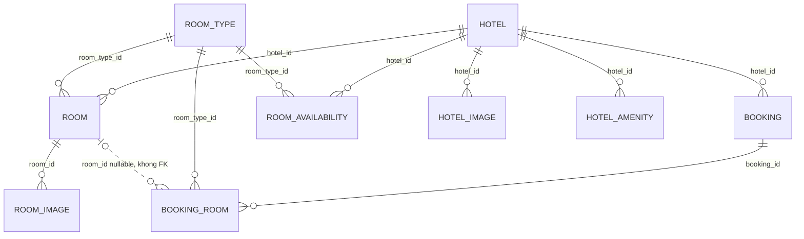
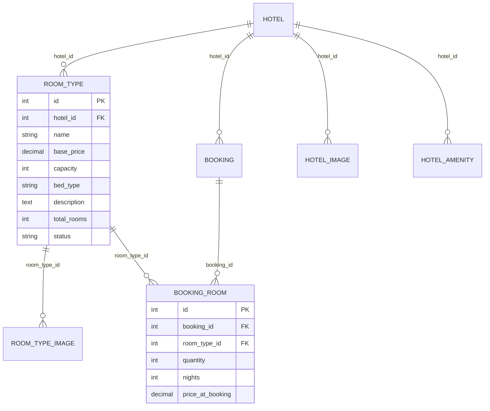
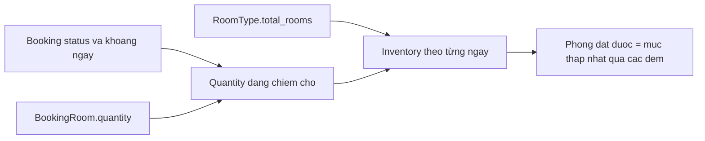

# AUREL — Phase 2A: phương án tái cấu trúc RoomType

Ngày kiểm tra: 11/10/2026. Đây là tài liệu thiết kế, chưa phải migration đã triển khai.

**Đề xuất:** mỗi cặp Hotel–RoomType cũ tạo một RoomType thuộc Hotel đó; giữ giá, sức chứa và nguồn ảnh hiện có. Tồn theo ngày trước mắt được tính từ `total_rooms` và BookingRoom.quantity, chưa cần lưu counter theo ngày. Giữ Room/RoomImage và các ID lịch sử trong giai đoạn chuyển tiếp. Việc dọn schema cũ cần phê duyệt riêng.

Chỉ bổ sung báo cáo này và [bảng ánh xạ dự kiến](hotel-roomtype-phase2a-mapping.csv). Không tạo migration/code ứng dụng, chạy migration/seeder, sửa UI/Authentication, bật checkout, ghi dữ liệu chính hoặc commit/push.

## 1. Kiến trúc và dữ liệu đã kiểm tra lại sau Phase 1

Đã đọc [Audit](hotel-room-management-audit.md), [kết quả Phase 1](hotel-room-management-phase1.md), Models, migration lịch sử, routes, các đường đọc/ghi Booking và phụ thuộc gián tiếp. Connection xác minh bằng Laravel/PDO: **mysql / 127.0.0.1:3306 / hotel_booking / MySQL 8.0.30**. Các truy vấn dữ liệu/schema thực hiện trong transaction READ ONLY, kết thúc rollback.

| Đối tượng | Kết quả hiện tại |
| --- | --- |
| Hotel | 21, gồm 11 active / 10 inactive; ID và trạng thái cần giữ nguyên. |
| RoomType | 6; không có hotel_id, total_rooms, status hoặc gallery trực tiếp. |
| Quan hệ Hotel–Type | 105 cặp; Type 1–5 dùng ở mỗi Hotel. Presidential id=6 chưa gắn Room/Hotel. |
| Room | 336, tất cả available. Mỗi Hotel có 5 Standard + 4 Superior + 3 Deluxe + 2 Suite + 2 Family. |
| Giá/sức chứa | Cả 336 Room khớp RoomType.base_price/capacity; mỗi cặp Hotel–Type chỉ có một giá và một capacity. |
| RoomImage | 336 dòng, file/URL đều được helper hiện có chấp nhận; mỗi cặp chỉ có một URL phân biệt, tổng 105 liên kết ảnh theo cặp nhưng chỉ 5 file ảnh phân biệt trên toàn bộ dữ liệu. |
| HotelImage / HotelAmenity | 21 / 190; giữ nguyên, không chuyển thành tiện nghi/ảnh phòng. |
| Booking / BookingRoom / Payment / Invoice | Đều 0 ở lần kiểm tra này. Phải xác minh lại trước chuyển đổi, không mặc định luôn bằng 0. |
| RoomAvailability | 0 dòng; code đang chạy tính tồn từ Room và Booking, không đọc counter bảng này. |
| Database objects | Không có view, trigger, routine hoặc event trong database hiện tại. |
| Migration | 66 bản ghi Ran, gồm migration xóa Staff batch 2; chưa có migration Phase 2. |

Không phát hiện Room thiếu Hotel/Type, ảnh orphan, Room price/capacity lệch Type, giá âm/capacity không hợp lệ hoặc BookingRoom trỏ sai Room trong dữ liệu đã đọc. Hai kiểm tra Booking không có bản ghi để chứng minh hành vi đơn thật.

Những thay đổi Phase 1 vẫn hiện diện: kiểm tra capacity ở server; Hotel/amenities transaction và cập nhật có chủ đích; tạo loại/phòng tránh trùng số; KPI đúng phạm vi; snapshot tiền/quantity; kiểm tra tồn khi khôi phục cancelled/expired; job hết hạn khóa và đọc lại Booking, không cộng ledger cũ. Không sử dụng kết luận lỗi cũ đã sửa như thể vẫn chưa sửa.

Các phụ thuộc chưa chuyển: RoomAvailabilityService đếm Room available; BookingService vẫn có nhánh room_id; Hotel Detail group `$hotel->rooms`; Home/Public API/Deals lấy giá từ room.price; Admin tạo loại vẫn sinh Room vật lý. Nút checkout hiện vẫn disabled cả trong Blade và JavaScript.

### ERD hiện tại

### ERD mục tiêu của phần nghiệp vụ

Inventory by Date là dữ liệu tính ra theo từng đêm, không mặc định là một bảng mới:

ERD mục tiêu không bao gồm kho lưu trữ/mapping kỹ thuật. Trong chuyển tiếp Room/RoomImage và Type legacy vẫn tồn tại; chúng được dọn ở một đợt riêng.

## 2. Schema đề xuất và nguồn dữ liệu

Giữ tên bảng số ít đang dùng. Không đổi các PK hiện tại hoặc kiểu giá. ID của Hotel/RoomType hiện là **INT signed**; FK mới phải cùng kiểu, không dùng `foreignId()` BIGINT unsigned một cách máy móc.

| Bảng/cột | Đề xuất | Nguồn/quy tắc |
| --- | --- | --- |
| room_type.hotel_id | Thêm INT signed + index + FK Hotel, NO ACTION khi xóa. Nullable lúc expand; bắt buộc cho mọi Type được API nghiệp vụ sử dụng. | Cặp room.hotel_id + room.room_type_id; một Type mới chỉ có một chủ sở hữu. |
| room_type.total_rooms | Thêm INT, giai đoạn đầu nullable; Type mới có số nguyên >= 0. | Số phòng có thể bán của cặp đã kiểm chứng; hiện toàn bộ available nên 5/4/3/2/2. Không lấy stock còn sau Booking làm tổng gốc. |
| room_type.status | Thêm VARCHAR(20), active/inactive, nullable cho legacy trong giai đoạn đầu. | Các Type mới active vì Room nguồn available; Hotel inactive vẫn ngăn bán ở cấp Hotel. Ngừng bán Type không xóa/hủy đơn cũ. |
| name / description / bed_type | Giữ VARCHAR(100) / TEXT / VARCHAR(50), nullable như schema hiện tại. | Copy Type nguồn, không suy diễn thêm diện tích/loại giường từ ảnh. |
| base_price | Giữ DECIMAL(12,2), giá mỗi phòng mỗi đêm. | Copy chính xác bằng decimal/string hoặc SQL, không backfill bằng float. Nguồn hiện khớp Room.price ở mọi cặp. |
| capacity | Giữ giới hạn tổng khách/phòng và validation hiện tại. | Source/UI hiện ghi tổng số khách, không có phân tách người lớn/trẻ em. |
| Sức chứa người lớn | Cần quyết định nguồn trước khi thêm/backfill max_adults. | Không tự đổi capacity thành sức chứa người lớn: Family capacity=4 không chứng minh cho phép 4 người lớn. Nếu xác nhận capacity chính là adult limit, mới lập bước đổi tên/mapping có tương thích API. |
| Trẻ em / phụ thu / giường phụ / diện tích | Chưa bổ sung. | Không có dữ liệu có cấu trúc và quy tắc tuổi/phí để backfill. |
| room_type_image | Bảng mới: id, room_type_id INT signed FK, image_url VARCHAR(500), is_primary, created_at. | Link ảnh Room đúng cặp; helper ảnh hiện có, không copy file/đổi URL tùy tiện. FK ảnh có thể CASCADE khi xóa Type không có lịch sử; Phase 2B ưu tiên ngừng bán. |
| room_type_legacy_map | Bảng kỹ thuật mới: hotel_id, old_room_type_id, new_room_type_id; unique(hotel_id, old_room_type_id), unique(new_room_type_id). | Các ID cũ/mới và Hotel đã xác minh; ghi ID thật trả về từ insert. FK tới Hotel và Type cũ/mới NO ACTION trong thời gian chuyển tiếp. Manifest ngoài DB lưu provenance/checksum. |
| booking_room | Giữ id, booking_id, quantity, nights, price_at_booking và FK Type. Có thể thêm CHECK quantity >= 1 / nights >= 1 sau kiểm tra dữ liệu. | Chỉ remap room_type_id khi chuyển dữ liệu. Giữ room_id nullable để đọc lịch sử, bỏ khỏi request đặt mới khi cutover. |
| room_availability | Giữ nguyên nhưng không dùng làm nguồn tồn thứ hai. | Bảng hiện rỗng; chỉ đề xuất bỏ sau khi toàn bộ tham chiếu đã hết và có phê duyệt. |

Ràng buộc đề xuất: total_rooms >= 0, capacity >= 1, base_price >= 0, status hợp lệ cho Type thuộc Hotel; index `(hotel_id,status,base_price)` nếu EXPLAIN trên DB test cho thấy cần. Không tạo unique theo tên: hai Type cùng tên nhưng khác giá/sức chứa vẫn là hai bản ghi riêng. Chỉ sau khi xử lý/archival các Type legacy mới siết hotel_id/total_rooms/status thành NOT NULL ở toàn bảng.

Không có bảng tiện nghi phòng. Giữ HotelAmenity đúng cấp Hotel; không tự gán tất cả tiện nghi khách sạn cho mọi phòng. RoomTypeAmenity hoặc chính sách JSON chỉ thuộc một phạm vi được phê duyệt sau này.

## 3. Tồn theo ngày và trạng thái Booking

### Nguồn tồn được khuyến nghị

Với tổng có thể bán cố định và chưa cần chặn phòng/đổi giá riêng từng ngày, **chưa cần bảng inventory theo ngày**. `RoomType.total_rooms` là tổng gốc, BookingRoom là nguồn cam kết; trả inventory theo ngày qua service. Tránh duy trì đồng thời counter legacy và lượng suy ra từ Booking.

Bảng theo ngày chỉ cần khi có yêu cầu đã chốt về số lượng có thể bán khác nhau từng ngày hoặc quy mô cần tối ưu materialization. Khi đó phải chọn một cơ chế cập nhật/khóa, xử lý giải phóng idempotent và reconcile; không thêm giá động vào bước này. room_availability có tồn tại không phải bằng chứng rằng cần sử dụng lại thiết kế counter đó.

### Những trạng thái nào giữ tồn?

| Trạng thái | Quy tắc chuyển tiếp bảo toàn hành vi hiện tại |
| --- | --- |
| pending | Giữ quantity trong khoảng lưu trú, kể cả expires_at đã qua nhưng status chưa được job đổi. Đây là cách giữ tồn thận trọng hiện tại. |
| confirmed | Giữ quantity. |
| completed | Vẫn tính quantity trong khoảng lưu trú. createManual(banking) hiện có thể gán completed ngay khi thanh toán, nên không thể coi completed luôn là đã checkout. |
| cancelled / expired | Không chiếm tồn. Job hiện đổi pending hết hạn thành cancelled; không tự đổi semantics job thành expired. |
| Giá trị chưa được biết | Giữ tồn thận trọng và báo bất thường; chặn thao tác chưa hiểu trạng thái, không âm thầm tính bằng 0. |

Tắt Hotel hoặc RoomType chặn đơn mới, giữ toàn bộ đơn cũ và cam kết tồn. Khôi phục cancelled/expired là tăng cam kết, phải kiểm tra lại tồn dưới lock. Không tự đổi hạn giữ chỗ 15 phút, cash/banking, quy tắc hủy hoặc refund.

### Thuật toán khả dụng

Cho `[check_in, check_out)`, mỗi đêm d thỏa check_in <= d < check_out:

`used(d) = tổng booking_room.quantity của Type đúng Hotel, trạng thái giữ tồn và booking.check_in <= d < booking.check_out`.

`remaining(d) = total_rooms - used(d)`; lượng đặt được cho cả chuyến là `min remaining(d)`, tương đương `total_rooms - max used(d)`. Trả 0 khi hiển thị thiếu hụt, nhưng giữ used thực và ghi nhận shortage, không che bằng cách sửa Booking. Checkout không tiêu thụ đêm tại ngày đó. Không cộng tất cả booking giao khoảng nếu chúng không cùng chiếm một đêm.

Triển khai bằng event sweep như service hiện tại: cắt interval vào khoảng yêu cầu, cộng quantity tại ngày nhận và trừ tại ngày trả, gộp delta cùng ngày trước tính peak. Bản mới không phân công/union room_id. Chỉ áp phép tổng quantity sau khi preflight xác minh không có các dòng phòng vật lý trùng đang được service cũ dedup.

### Transaction và cạnh tranh

1. Trong transaction, khóa Hotel trước như Phase 1; khóa Type đúng Hotel theo id tăng dần; sau đó khóa Booking nếu là thay đổi một đơn hiện có.
2. Đọc trạng thái Hotel/Type, capacity và total_rooms từ DB sau lock. Đọc cam kết mới nhất sau khi khóa, tránh relation/cache/snapshot có từ trước lúc chờ lock.
3. Kiểm tra ngày, ownership, quantity 1–10 như hiện tại, sức chứa và đủ tồn toàn khoảng; insert Booking + BookingRoom + snapshot tiền trong cùng transaction.
4. Các đường tăng/giải phóng cam kết, điều chỉnh tồn, thay ngày hoặc khôi phục đều dùng cùng thứ tự khóa. Không dùng SKIP LOCKED để bỏ qua đơn đang giữ tồn.
5. Email/PDF và gọi mạng để sau commit; retry deadlock có giới hạn không được phát lại side effect hoặc tạo đơn trùng.

`FOR UPDATE` đọc dữ liệu mới nhất và giữ khóa đến khi transaction kết thúc; bỏ qua các dòng đang khóa có thể tạo góc nhìn thiếu dữ liệu. Đây là lý do chọn khóa cùng chủ sở hữu cho mọi writer. [MySQL: Locking Reads](https://dev.mysql.com/doc/refman/8.0/en/innodb-locking-reads.html).

Khóa Hotel làm tuần tự các loại trong cùng khách sạn nhưng tương thích cách Phase 1 đã kiểm thử. Chưa tối ưu thành chỉ khóa Type khi các writer cũ vẫn khóa Hotel.

**Giảm total_rooms:** dưới cùng lock, tính peak cam kết từ ngày hiệu lực đến checkout cuối cùng của tất cả đơn còn chiếm chỗ, gồm đơn đã check-in nhưng chưa checkout. Chỉ cho giảm khi tổng mới >= peak. Không chỉ kiểm tra hôm nay, 30/90 ngày hoặc các booking có check_in trong tương lai. Đơn giữ chỗ xa hơn vẫn phải được bảo vệ. Thay đổi theo ngày hiệu lực trong tương lai cần model lịch tổng tồn riêng, chưa đề xuất triển khai ở bản tối giản.

config/app.php hiện timezone UTC, còn check-in/out là DATE. Cần chốt định nghĩa ngày hiệu lực và timezone khi làm editor tồn; không tự đổi APP_TIMEZONE trong chuyển đổi. Với ví dụ tính tồn, DATE là ngày lịch, không chuyển checkout thành đêm vì chênh UTC.

## 4. Chuyển 336 Room và bảo toàn giá/ảnh/Booking

### Bảng đối chiếu dự kiến

[CSV](hotel-roomtype-phase2a-mapping.csv) có **105 nhóm ánh xạ + 1 dòng Presidential chờ quyết định**. Có toàn bộ ID Hotel/Type cũ, danh sách 336 Room ID và 336 RoomImage ID, giá Room/Type trước chuyển, giá/sức chứa/tổng tồn sau dự kiến và URL ảnh nguồn. `new_room_type_id_NOT_ASSIGNED` để trống: chưa insert và không giả ID mới. `H{hotel_id}-T{old_id}` là khóa đối chiếu trong tài liệu, không phải khóa mới trong database.

| Type cũ | Phòng mỗi Hotel → total_rooms | Giá trước/sau (VND/đêm) | capacity giữ nguyên | bed_type |
| --- | ---: | ---: | ---: | --- |
| 1 Standard | 5 | 500.000 | 2 | Double |
| 2 Superior | 4 | 800.000 | 2 | Double |
| 3 Deluxe | 3 | 1.200.000 | 2 | King |
| 4 Suite | 2 | 2.500.000 | 3 | King |
| 5 Family | 2 | 1.800.000 | 4 | Twin |
| 6 Presidential | 0; chưa có Hotel | 5.000.000 nguồn, chưa có giá Type mới | 4 nguồn | King |

Trong giai đoạn giữ legacy: **6 Type cũ + 105 Type mới = 111 dòng**, trong đó chỉ 105 Type có ownership mới. Không gán lại Type id 1–5 cho một Hotel rồi dùng chúng như của mọi Hotel. Không tạo 21 Presidential hoặc tự cấp tổng tồn cho loại chưa sử dụng. ID insert có thể bắt đầu khác 7 do AUTO_INCREMENT hiện có khoảng trống; lấy ID thật và lưu map, không tính bằng công thức.

### Quy trình backfill được đề xuất

- Group theo `(hotel_id, old_room_type_id)`, không theo name. Kiểm tra tính đồng nhất giá/capacity trong từng nhóm và đối chiếu Type nguồn trước khi ghi. Nếu tương lai có nhiều giá/capacity trong cùng nhóm, dừng nhóm để người dùng chọn tách variant hay xử lý nguồn; không lấy min/avg/first để che khác biệt.
- Clone Type, gán đúng Hotel, copy name/description/bed_type/capacity/base_price và metadata cần giữ; total_rooms lấy nhóm đã kiểm chứng. Giữ mọi Hotel ID/status; Type active không vượt qua Hotel inactive.
- Tạo mapping và ảnh của cặp trong DML transaction. Run có manifest/checksum, unique mapping làm cơ sở chạy lại: cùng nguồn thì xác minh rồi bỏ qua; checksum lệch thì dừng, không overwrite editor mới bằng upsert.
- Resume dùng khóa nguồn trong manifest gốc và map đã lưu, không coi room_type_id đã remap trên Room là một Type legacy mới để clone lần nữa. Chỉ nhận nguồn legacy chưa có owner; Type đã có hotel_id phải khớp new_room_type_id của map thì xác minh/bỏ qua, nếu không khớp phải dừng. Test chạy lại phải bao gồm cả sau khi FK đã chuyển, không chỉ sau insert clone.
- Sau kiểm chứng, khóa Hotel trong cửa sổ ngừng ghi; remap `room.room_type_id` sang Type mới. Giữ Room.id, room_number, floor, price, capacity, status và RoomImage nguyên vẹn. Code cũ còn đọc theo Room vẫn thấy đúng loại/giá/capacity ở thời điểm này.
- Remap `booking_room.room_type_id` theo **booking.hotel_id + Type cũ** trong cùng transaction của Hotel; không lấy Type theo name. Giữ Booking.id, BookingRoom.id, room_id, quantity, nights, price_at_booking, total_price, trạng thái, payment/invoice/review và FK Booking hiện có.
- Nếu room_availability phát sinh dữ liệu trước triển khai, phải audit semantics/reconcile riêng rồi mới map theo Hotel/Type; không coi counter stale là nguồn tổng mới. Không tự xóa hay gộp counter.

Không cần thêm shadow FK mới vào BookingRoom ở phương án tối giản; mapping kỹ thuật giữ quan hệ cũ/mới. API tương thích có thể giải quyết ID Type cũ bằng Hotel + map trong thời gian hữu hạn, còn writer chuẩn phải lưu ID Type mới. Đây không phải quyền dùng Type của Hotel khác.

### Bảo toàn ảnh

Dedup **chỉ trong đúng cặp Hotel–Type**, dựa trên URL hợp lệ đã canonicalize. Dữ liệu hiện tại sẽ tạo 105 RoomTypeImage liên kết cùng 5 file đang có; giữ URL nguồn trong CSV, không copy file hoặc lấy thêm ảnh Hotel/Hotel khác để lấp gallery. Một URL trong một nhóm đã là primary, không có xung đột chọn cover hiện tại. Nếu nhiều ảnh primary khác nhau xuất hiện sau audit, cần xác định cover/giữ gallery có thứ tự; không xóa ảnh nguồn.

ImageAssignSeeder hiện gán ảnh theo Type cho mọi Hotel. Do đó chỉ xác minh file và provenance kỹ thuật; **không chứng minh ảnh chụp đúng từng khách sạn/phòng**. Nếu cần xác thực sự phù hợp nội dung, người dùng phải duyệt ảnh hiện có. Ảnh thiếu/hỏng dùng placeholder khi render, không ghi ảnh giả/placeholder để thay dữ liệu nguồn.

### Booking cũ và các trường hợp không tự map

Hiện 0 Booking giúp chuyển đơn giản hơn, nhưng vẫn phải có test lịch sử và preflight lúc thực thi. Các dòng assigned trùng Room, quantity > 1 cho một Room, Room không thuộc Hotel, nhiều booking cùng Room giao ngày, hoặc Type của booking không còn nhóm Room tương ứng đều cần xử lý thủ công. Không dedup/xóa dòng BookingRoom để làm số tồn đẹp hoặc thay snapshot tiền.

Tên Hotel/Type hiện chưa có snapshot đầy đủ trong BookingRoom. Clone giữ tên tại chuyển đổi; đổi tên sau này vẫn có thể ảnh hưởng History. Snapshot tên để cố định lịch sử là yêu cầu riêng, không được lén backfill như dữ liệu đã có. Với tên/ảnh hiện có, giữ legacy và manifest để đối chiếu.

## 5. Khóa ngoại, schema cũ và các phụ thuộc gián tiếp

| Constraint thực tế | Quan hệ / delete rule | Tác động |
| --- | --- | --- |
| fk_room_hotel | room.hotel_id → hotel.id / CASCADE | Giữ Hotel; tránh hard delete làm mất Room và ảnh chuyển tiếp. |
| fk_room_type | room.room_type_id → room_type.id / NO ACTION | Remap tới Type mới có tồn tại trước; giữ Room tới khi code hết phụ thuộc. |
| fk_room_image | room_image.room_id → room.id / CASCADE | Xóa Room sẽ xóa ảnh nguồn; chỉ dọn sau backup/provenance và so sánh gallery mới. |
| fk_br_room_type | booking_room.room_type_id → room_type.id / NO ACTION | Bảo toàn dòng và ID, chỉ đổi FK theo mapping đúng Hotel. |
| fk_br_booking | booking_room.booking_id → booking.id / CASCADE | Không xóa/recreate Booking để chuyển Type. |
| fk_avail_hotel / fk_avail_room_type | room_availability → hotel/room_type / CASCADE | Giữ và kiểm lại nếu số dòng không còn 0. |
| idx_booking_room_room_id | room_id nullable có index, **không có FK** | Có thể có dangling reference; kiểm dữ liệu và consumers trước đề xuất bỏ cột. |
| fk_booking_hotel/customer/chat | booking → Hotel/Customer/Chat; NO ACTION, Chat SET NULL | Không sửa parent/key; bảo toàn quan hệ. |
| fk_invoice_booking / fk_payment_booking / fk_review_booking | Invoice NO ACTION; Payment CASCADE; Review SET NULL | Không recreate/xóa Booking; bảo toàn lịch sử và dữ liệu tiền. |

InvoiceItem lưu description/quantity/unit_price/amount, không FK trực tiếp RoomType. Email/PDF còn đọc `br->room->room_number`; Location có hasManyThrough(Room). Đây là phụ thuộc code dù không có FK incoming bổ sung tới Room.

Sau khi hết phụ thuộc mới đề xuất: archive Type legacy, remap/drop FK kỹ thuật cũ của mapping, siết RoomType owner NOT NULL; bỏ nhánh/quan hệ room_id, rồi cột room_id/index, RoomImage và cuối cùng Room; room_availability xử lý riêng. Mapping cần giữ trong archive để truy lịch sử sau khi dọn FK nguồn. Chỉ siết NOT NULL khi Presidential và mọi Type legacy đã có phương án được duyệt. Không sửa migration lịch sử hoặc xóa bảng trong Phase 2B đề xuất đầu tiên.

Ở đợt dọn được duyệt, thứ tự cụ thể với 6 Type legacy là: copy đủ bản ghi/ID vào archive thật → đối chiếu → chuyển FK old_room_type_id của mapping sang archive hoặc bỏ FK đó có chủ đích → xác nhận mọi FK nghiệp vụ không còn trỏ Type cũ → mới xóa các dòng legacy đã archive → siết ownership NOT NULL. Không xóa Type cũ trước khi xử lý FK của mapping và không bỏ Presidential vì đang không có Room.

Mã mapData còn tham chiếu v_map_hotels/map_search_log, trong khi schema hiện tại không còn chúng do migration cleanup lịch sử. Đây là lệch code/schema có sẵn, không phải view/FK đang hoạt động phải remap. Chưa gọi endpoint để kiểm thử HTTP; không tạo lại view/bảng trong Phase 2A.

## 6. Triển khai, backup và khôi phục

MySQL CREATE/ALTER/DROP có implicit commit; transaction bao toàn bộ Laravel migration không thể undo chuỗi DDL. Atomic DDL của MySQL 8 bảo vệ từng statement được hỗ trợ, không biến nhiều statement/migration thành một transaction rollback toàn phần. [MySQL: Implicit Commit](https://dev.mysql.com/doc/refman/8.0/en/implicit-commit.html), [Atomic DDL](https://dev.mysql.com/doc/refman/8.0/en/atomic-ddl.html).

Nếu một migration Pending nhưng một vài column/index/table đã tồn tại sau lỗi DDL, lệnh chạy lại phải đối chiếu đúng kiểu/nullability/FK và checkpoint, không chỉ thấy tên tồn tại rồi đánh dấu thành công. Bản schema khác dự kiến phải dừng để duyệt bước sửa; không tự chạy migrate:fresh, refresh, db:wipe hoặc rollback hàng loạt để làm sạch.

| Bước | Nội dung / cổng kiểm tra | Khôi phục nếu lỗi |
| --- | --- | --- |
| 0 — xác nhận nguồn | Refresh manifest, count/FK/giá/ảnh/booking; xác minh host/database/version. Nếu lệch, dừng trước ghi. Chuẩn bị backup có SHA-256 và thử restore riêng. | Chưa có thay đổi. |
| 1 — expand | Migration mới nhỏ: cột nullable; index/FK; bảng ảnh; bảng mapping. Có thể tách các DDL thành nhiều migration được chỉ định rõ. | Ghi nhận statement đã hoàn thành; inspect schema thay vì giả định toàn bộ rollback. DDL thừa để lại an toàn khi app cũ chưa dùng, dọn bằng bước riêng được duyệt. |
| 2 — backfill | Tạo 105 clone/map/gallery; mỗi Hotel một DML transaction, checkpoint và checksum. Không DDL trong transaction dữ liệu. | Hotel đang lỗi rollback DML; phần đã commit có manifest để resume. Không delete mọi Type mới một cách mù quáng. |
| 3 — reconcile/remap | Tạm ngừng mọi writer liên quan; map Room/BookingRoom theo Hotel, kiểm snapshot và tồn trước/sau. | Reverse FK theo map khi không có dữ liệu V2 mới; không đổi giá/quantity/id. Nếu không đủ điều kiện, giữ ngừng ghi và phục hồi trên DB riêng để đối chiếu. |
| 4 — chuyển đọc/ghi | Deploy Services/API/adapter, ownership/status/total guard và binding dữ liệu tương thích. Các writer trạng thái Booking cùng khóa; vẫn không mở checkout. | Có thể quay lại code đọc cũ khi total/price/capacity và Room còn khớp, chưa có delta V2; không coi tắt feature flag luôn là rollback đủ. |
| 5 — xác minh | Test trên DB riêng đạt, read-only kiểm nguồn thật sau triển khai được phê duyệt; đối chiếu đầy đủ và duyệt các ngoại lệ. | Forward fix hoặc khôi phục được duyệt; giữ khả năng reconcile đơn phát sinh, không mất đơn mới. |
| 6 — dọn schema | Một đợt phê duyệt khác sau khi không còn đọc/ghi Room/RoomImage/room_id và backup được thử restore. | down không thể tái tạo chính xác phòng/ảnh/historic IDs từ số lượng tổng; dùng backup thật và mapping, không sinh Room 101/102 giả để rollback. |

Backup cần toàn bộ schema/dữ liệu, lịch sử migrations, assets ảnh và manifest; bảo quản ngoài web root với quyền hạn chế. Với InnoDB có thể dùng consistent dump, nhưng phải phối hợp ngừng DDL/ghi liên quan, ghi mốc thời gian/binlog nếu sử dụng, và **restore thành công trên database riêng** trước khi coi backup hợp lệ. Phase 2A không tự chạy backup/restore hoặc tạo user database.

Cửa sổ chuyển đổi phải chặn cả POST API còn truy cập được dù nút checkout khóa, thao tác Admin, scheduler hết hạn, queue và payment callback; không chỉ khóa UI. Không thay Authentication để thực hiện chặn ghi. Callback đang tới phải có phương án lưu/đợi/thử lại và đối soát; không xác nhận đơn bị giải phóng chỗ mà không kiểm tồn. Chốt phương án callback trước thao tác chính.

Sau khi V2 cho đổi total_rooms/giá/capacity hoặc tạo Booking mới không dựa Room, code cũ đếm Room sẽ không còn tương đương. Không restore toàn DB về backup cũ làm mất đơn/thanh toán mới; cần forward fix hoặc merge/khôi phục được phê duyệt với manifest và delta phát sinh. Bước down phải từ chối khi không đủ điều kiện, không âm thầm xóa dữ liệu mới.

## 7. File sẽ bị ảnh hưởng khi được duyệt triển khai

| Nhóm | File/đường cụ thể và việc cần làm |
| --- | --- |
| Schema/backfill mới | database/migrations: migration expand/index/FK/images/map mới; command backfill/reconcile mới tại app/Console/Commands; chưa tạo file nào ở Phase 2A. |
| Models | app/Models/Hotel.php, RoomType.php, Booking.php, BookingRoom.php, Location.php; RoomTypeImage mới. Room.php/RoomImage.php giữ adapter/history trước khi dọn. |
| Tồn/Booking | app/Services/RoomAvailabilityService.php; BookingService.php; app/Http/Controllers/BookingController.php; RoomController.php; CancelExpiredBookings.php. Thay nguồn tổng, bỏ selection vật lý ở writer mới, giữ snapshot. |
| Admin đang chạy | app/Http/Controllers/AdminController.php: create/get/edit Type ownership, tổng tồn, status, thống kê số phòng và restore. routes/api.php thêm/update contract sau phê duyệt; giữ middleware hiện tại. |
| Public/Web/Deals | app/Http/Controllers/HotelController.php, Webcontroller.php, DealsController.php; RoomType/gallery mới và giá tối thiểu mới. Giữ alias rooms_min_price cho consumer hiện tại trong giai đoạn adapter. |
| Writer gián tiếp | app/Http/Controllers/PaymentController.php (expire/createManual), Webcontroller.php::paymentResult; app/Services/PaymentService.php nếu tái sử dụng. Những đường này ghi status ngoài cơ chế khóa mới, cần đưa vào kiểm tra chung; không tự đổi ý nghĩa cash/banking. |
| Blade/JS sẽ cần đổi binding | resources/views/Hotel-detail.blade.php (group từ Room), partials/hoteldetail/rooms-section, rooms-script, sidebar-script, modals-script, similar-section; resources/views/admin/hotels.blade.php, bookings.blade.php, customers.blade.php. Không thiết kế lại UI ở Phase 2A. |
| Giá/ảnh consumer | resources/views/partials/home/card, script, hero-script; partials/deals/*; Dashboard.blade.php và user/itineraries/itineraries-script giữ contract alias nếu có thể. Home không cần đổi thiết kế. |
| Ảnh dùng chung | app/Models/Concerns/HasAccommodationImages.php tái sử dụng cho Type; AccommodationImage.php; partials/accommodation-images.blade.php chỉ thay nếu contract mới cần. Không thêm image library. |
| Invoice/email/PDF | app/Http/Controllers/InvoiceController.php, app/Mail/BookingConfirmed.php, resources/views/emails/booking_confirmed.blade.php, pdf/invoice.blade.php; bỏ phụ thuộc room_number khi history đã có cách đọc tương thích. Giữ số tiền/dòng hóa đơn. |
| Code chưa được routes dùng | app/Services/HotelService.php (namespace còn lệch đường PSR-4), Services/Admin/HotelService.php, Admin/BookingService.php, Admin/CustomerService.php, Http/Controllers/Admin/HotelController.php, Admin/BookingController.php, Admin/CustomerController.php; InvoiceService.php, PaymentService.php. Không vô tình chuyển sang bản cũ chưa có guard Phase 1; tái sử dụng/loại bỏ phải được quyết định riêng. |
| Seeders | DatabaseSeeder.php, HotelBookingSeeder.php, ImageAssignSeeder.php cần cập nhật cho môi trường cài/test sau này; không chạy chúng trên DB chính hoặc dùng chúng làm migration dữ liệu đang có. |
| Tests/docs | BookingEligibilityTest.php, HotelBookingPhaseOneTest.php, AccommodationImagesTest.php, HotelDetailPresentationTest.php, frontend phase1 test; fixture/bootstrap/worker riêng cho Phase 2; ARCHITECTURE.md và README-VI.md cập nhật khi code thật được đổi. |

Routes đang chạy dùng AdminController ở root, không phải các controller Admin/ riêng. Không thay route sang service duplicate chỉ vì tên phù hợp. Hotel Image/Amenity, Customer/Wishlist/Review/Itinerary/Payment/Invoice keys giữ nguyên; ảnh gợi ý khách sạn chỉ cần contract giá/Type nếu consumer có dùng.

Public GET `/rooms` hiện trả các dòng vật lý. Có thể thêm GET `/hotels/{id}/room-types` làm contract chuẩn và giữ `/rooms` adapter ngắn hạn; không tạo Room giả/ID giả để giữ hình dạng API. Các consumer phải được nâng cấp có chủ đích. POST Booking chuẩn dùng Type ID thuộc đúng Hotel, quantity; gửi room_id mới bị từ chối rõ ràng khi cutover đã duyệt. Các ID Type cũ được resolve có phạm vi Hotel qua map, không lookup toàn cục.

## 8. Kiểm thử phải thực hiện trong Phase 2B

**Không chạy suite migration/fixture trong Phase 2A.** Việc kiểm tra dữ liệu nguồn ở trên là audit READ ONLY, không phải chứng minh migration mới đã PASS.

Ưu tiên MySQL 8 trên server/port riêng hoặc database riêng với credentials chỉ có quyền trên DB test. Bootstrap phải force cấu hình test và chặn tên/connection nguồn **trước khi mở connection hoặc boot ứng dụng**; kiểm tra SELECT DATABASE chỉ được thực hiện sau guard này. Test/worker không đọc .env để kết nối nguồn, không gọi API live. DDL fixture lấy từ artifact schema đã chuẩn bị hoặc chain migration chạy chỉ trên DB test; không sao chép tài khoản/token thật.

Runner Phase 1 hiện đọc schema database chính trước khi tạo DB tạm. **Không tái sử dụng nguyên runner đó cho Phase 2B**, vì yêu cầu lần này không cho tiến trình test kết nối database chính kể cả chỉ đọc. Cần runner độc lập nhận schema/fixture và cấu hình test đã có, với test chứng minh guard từ chối nguồn trước kết nối. SQLite RAM chỉ phù hợp unit/render; concurrency, FK/DDL và implicit commit phải dùng MySQL riêng.

| Nhóm | Test cases bắt buộc / kết quả mong đợi |
| --- | --- |
| Ownership | Type cùng tên ở Hotel A/B có ID riêng; không đọc/edit/book Type của Hotel khác; owner không đổi sau tạo. |
| Giá/capacity | Hai Hotel giá/capacity khác nhau không ảnh hưởng nhau; Room.price khác Type/nhóm nhiều biến thể thì preflight chặn, không tự lấy min/avg. |
| Backfill dữ liệu thật dạng fixture | 21 Hotel, 6 Type, 336 Room → 105 owned Type + 6 legacy, tổng 336; từng Room/Image ID được map đúng một nhóm; chạy lại không thêm clone. |
| Giá/ảnh | DECIMAL copy chính xác; các URL/gallery đúng Hotel/Type; 336 refs → 105 refs trong fixture tương đương nguồn; ảnh thiếu/không hợp lệ dùng fallback render, không sinh ảnh trong DB. |
| Mapping lịch sử | Cả room_id null và assigned, qty 1/2/3, hai Hotel dùng cùng Type cũ; Booking/BookingRoom ID, qty, nights, snapshot tiền, payment/invoice/review không đổi. ID chưa map, duplicate assigned, wrong Hotel, dangling Room phải chặn và báo. |
| Tồn từng đêm | Giao ngày toàn bộ/một phần, không giao, nhiều đơn không cùng đêm; checkout = check-in kế tiếp không tiêu thụ hai lần; peak và remaining đúng. |
| Concurrent create | Hai process tranh phòng cuối cùng cùng Type/Hotel; một thắng, một bị từ chối. Hai Hotel độc lập không dùng chung stock. |
| Cancel/expiry/restore | Pending/confirmed/completed giữ tồn; cancelled/expired giải phóng; pending hết giờ còn status cũ vẫn giữ; job recheck sau lock; chạy job/hủy lặp không credit hai lần; khôi phục thiếu tồn bị chặn. |
| Callback race | Job/cancel/restore cạnh tranh callback xác nhận và createManual; kiểm status/tồn/idempotency dưới lock, không resurrect đơn vượt tồn hoặc đổi công thức/hoàn tiền ngoài quyết định. |
| total_rooms | Giảm bằng peak được; thấp hơn peak bị chặn; gồm đơn đang lưu trú và đơn xa hơn 90 ngày. Tăng/giảm tranh create/restore cùng lock; không hủy Booking để đạt tổng mới. |
| Ngừng bán | Type/Hotel inactive chặn new Booking, kể cả request validation qua trước khi Admin tắt; đơn cũ/history/invoice vẫn đọc được và không tự giải phóng cam kết. |
| CRUD/API/UI | Admin Type create/edit/status/total, quyền đúng; Hotel Detail không dựa room_number; Home/Deals/min-price alias và History lượng/ảnh hoạt động; checkout vẫn khóa theo phạm vi. |
| Partial failure | DDL lỗi giữa các bước, backfill lỗi Hotel thứ N, checksum source đổi, chạy lại/resume/reverse FK; không mất phần đã commit hoặc dữ liệu mới. |
| Restore | Restore backup vào DB riêng, khớp schema/count/checksum/ảnh; down từ chối khi có delta/new Booking không thể phục hồi an toàn. |
| Regression | Authentication Admin/Customer, capacity/amenities/KPI/price snapshots Phase 1, Booking/Payment/Invoice, mã ảnh và các consumer cũ đều kiểm trên test DB. |

Unique `uq_booking_prevent_duplicate(customer_id,hotel_id,check_in,check_out,status)` còn tồn tại. Cần test cancel/đặt lại và constraint collision; không thay unique hoặc bổ sung cart nhiều loại chỉ vì đổi RoomType. Nếu muốn Booking nhiều loại trong một đơn, cần đặc tả riêng, không tự đổi luồng đặt một loại hiện tại.

## 9. Những quyết định cần chốt và thứ tự Phase 2B

| Quyết định | Khuyến nghị trước khi triển khai |
| --- | --- |
| Inventory | Tính từ total_rooms + BookingRoom theo đêm; chưa tạo bảng daily counter. Chỉ thêm daily inventory khi có yêu cầu stock khác nhau theo ngày đã được duyệt. |
| Presidential / legacy | Giữ nguyên id=6 trong khu vực legacy, không tự gán Hotel/tồn. Chọn archive giữ đủ dữ liệu hoặc chỉ cấp cho Hotel được chỉ định với thông tin nguồn thật. |
| Người lớn/trẻ em | Giữ capacity tổng khách trước; xác nhận nguồn adult limit trước khi thêm/đổi trường. Không tự đặt age bands/phí. |
| Ảnh | Bảo toàn link nguồn; cần duyệt nội dung nếu yêu cầu ảnh đúng từng cơ sở. Không lấy ảnh cùng tên Type ở Hotel khác để bổ sung. |
| completed và thanh toán | Giữ completed chiếm tồn vì semantics code hiện có; state machine/late callback/refund cần quyết định riêng nếu muốn đổi. |
| Cửa sổ ghi / backup | Chốt ngừng writer/queue/callback, backup hợp lệ đã restore thử, người phê duyệt và tiêu chí resume trước mọi ghi production. |
| Schema cũ | Giữ Room/RoomImage/room_id/Type legacy trong đợt đầu; cleanup và siết NOT NULL sau archive là phê duyệt riêng. |

Thứ tự đề nghị chia thành các gói kiểm tra được, không triển khai toàn Phase 2 trong một lần:

1. **2B.1 trên DB riêng:** chuẩn bị migration expand, mapping/backfill/reconcile/restore, static schema fixture và guard test độc lập. Chưa đổi production/API/UI.
2. **2B.2 trên DB riêng:** chuyển service tồn và ownership, đưa mọi writer trạng thái vào cùng cơ chế khóa; test lịch sử/callback/concurrency và so sánh source với target. Đánh giá adapter và điều kiện rollback.
3. **Cổng duyệt ghi chính:** refresh manifest, chốt các quyết định trên, backup/restore proof và maintenance. Chỉ sau phê duyệt mới áp đúng migration expand và backfill/remap đã kiểm thử, có checkpoint.
4. **2B.3 triển khai code có kiểm soát:** Services/API và binding dữ liệu Admin/Hotel Detail chuyển sang Type riêng; giữ routes/alias cần thiết, không đổi Authentication hoặc bật checkout. Không mở editor tổng/giá V2 trước khi điều kiện rollback được chấp nhận.
5. **2B.4 xác minh:** đối chiếu 21 Hotel/105 Type/336 tổng tồn/105 ảnh/snapshot, kiểm tra đọc nguồn thật và regression bằng môi trường riêng; báo cáo sai khác và xác nhận trước khi mở phạm vi tiếp.
6. **Đợt dọn sau, phê duyệt riêng:** archive Type legacy/Presidential, xử lý FK mapping, rồi đề xuất bỏ RoomImage/room_id/Room/RoomAvailability. Không đặt drop vào migration expand/backfill.

## 10. Xác minh thực hiện ở Phase 2A

- Đã chạy route:list, đọc schema/FK/objects và các aggregate/provenance bằng READ ONLY; không gọi endpoint ghi, scheduler, job hết hạn hay Authentication thật.
- Đối chiếu manifest: 105 nhóm, 21 Hotel, 336 Room ID không trùng/không thiếu, 336 RoomImage ID không trùng/không thiếu; giá/capacity của tất cả nhóm khớp nguồn; 105 ảnh sau dedup đúng cặp, Presidential chưa map. Đây là kiểm chứng kế hoạch, không phải kết quả migration đã chạy.
- Đối chiếu 25 schema trước–sau: tất cả khớp; 24 bảng có toàn bộ dữ liệu khớp SHA-256, gồm Hotel/Type/Room/ảnh/amenities/Booking/Payment/tài khoản và migration. Booking vẫn 0, không có bảng Phase 2 được tạo.
- Ngoại lệ metadata: personal_access_tokens vẫn 1 dòng, last_used_at và updated_at từ 2026-10-11 09:11:20 sang 2026-10-11 16:11:53 trong thời gian audit. Dùng bản sao hàng chỉ trong RAM thay lại hai timestamp này cho hash trùng snapshot ban đầu, chứng minh các trường khác, gồm ID/giá trị/quyền token, không đổi. Các truy vấn audit không ghi/token-auth; thay đổi phù hợp cách Sanctum cập nhật thời gian sử dụng khi có hoạt động phiên, chưa xác định request cụ thể. Không sửa/khôi phục timestamp và không tuyên bố mọi byte của database đều không đổi.
- Fingerprint 515 đường file Git/.env trước task, bao gồm các trạng thái xóa có sẵn, khớp sau khi loại riêng hai tài liệu mới. Code ứng dụng, UI, Authentication, .env, migration và toàn bộ thay đổi trước task được giữ nguyên. git diff --check đạt; CSV đọc lại xác nhận 105 nhóm/336 Room/336 ảnh/1 Type chưa map và không có ID mới nào được gán.
- Chỉ tạo hai tài liệu Phase 2A. Không tạo schema mới hoặc test fixture trên database chính; không chạy test kết nối database chính, migration/seeder, commit/push hoặc chỉnh code ứng dụng.

**Dừng ở thiết kế. Chưa được coi báo cáo này là phê duyệt chạy migration hoặc bắt đầu sửa code Phase 2B.**
